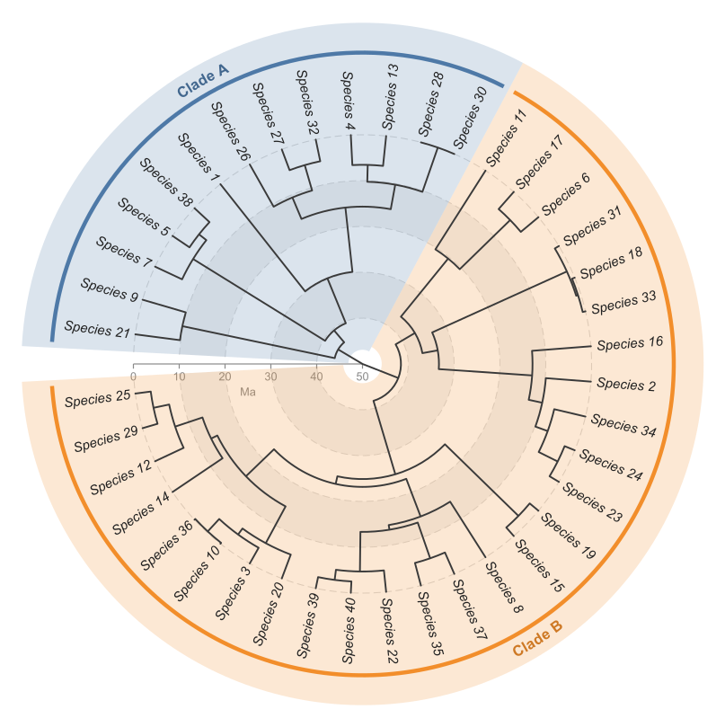

# PlotPhyloTree.jl

[](https://evoart.github.io/PlotPhyloTree.jl/stable/)
[](https://evoart.github.io/PlotPhyloTree.jl/dev/)
[](https://github.com/EvoArt/PlotPhyloTree.jl/actions/workflows/CI.yml)

Phylogenetic tree figures in pure Julia. Rectangular, circular and fan layouts;
clade highlights and labels, support values, node pies, age bars, time scales,
heatmap and bar rings, images and legends. Output to SVG, PNG, PDF, TikZ and
CeTZ (Typst), or into a Makie figure.

> **Work in progress:** in TikZ and CeTZ output, rotated labels and curved
> clade labels can come out at the wrong angle or spacing.

```julia
using Pkg; Pkg.add("PlotPhyloTree")
```

```julia
using PlotPhyloTree, Random
tree = randtree(40; rng=Xoshiro(2), height=50, labels=["Species_$i" for i in 1:40])
ladderize!(tree)
p = treeplot(tree; layout=:circular, italic=true)
highlight!(p, tipnames(tree)[1:9]; label="Clade A")
highlight!(p, tipnames(tree)[24:33]; label="Clade B")
timescale!(p; title="Ma")
savefig("tree.svg", p)
```

<p align="center"></p>

This release bundles the [PhylogenyIO.jl](https://github.com/EvoArt/PhylogenyIO.jl)
tree implementation and re-exports `readnewick` and `readnexus`. Tree types in
`PhyloBuilder` and `PlotPhyloTree` are temporarily distinct; pass a Newick
string or file between them.
