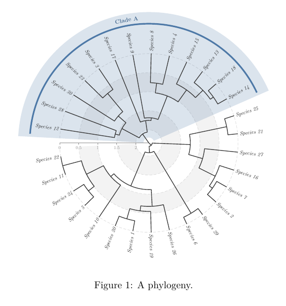

# TikZ / LaTeX

Saving to `.tikz` writes a `tikzpicture` to `\input` into a LaTeX document.
Saving to `.tex` writes a standalone document instead.

!!! warning "Work in progress"
    Rotated tip labels and curved clade labels can come out at the wrong
    angle or spacing. Check them in your output.

```julia
using PlotPhyloTree, Random
tree = randtree(30; rng=Xoshiro(1), labels=["Species_$i" for i in 1:30])
ladderize!(tree)
p = treeplot(tree; layout=:circular, italic=true, metrics=:lmroman)
highlight!(p, childnodes(tree, rootnode(tree))[1]; label="Clade A")
timescale!(p)
savefig("tree.tikz", p)
```

`main.tex`:

```latex
\documentclass{article}
\usepackage[T1]{fontenc}
\usepackage{lmodern}
\usepackage{tikz}
\usetikzlibrary{decorations.text}   % curved clade labels
\begin{document}

\begin{figure}
  \centering
  \resizebox{0.8\linewidth}{!}{\input{tree.tikz}}
  \caption{A phylogeny.}
\end{figure}

\end{document}
```

`pdflatex main.tex`:



## Fonts

The branches, wedges, rings and symbols are drawn where the layout put them.
The labels are handed to LaTeX as text, so they are set in the document's
font. Change the document's font and the tree's labels change with it.

To set the font for the trees only:

- wrap the picture in a font switch: `{\sffamily\input{tree.tikz}}`;
- define `\PlotPhyloTreeFont` in the preamble to affect every tree, e.g.
  `\newcommand\PlotPhyloTreeFont{\sffamily}`;
- or pass LaTeX code for one figure: `tikzstring(p; font="\\sffamily")`.

The layout reserves room for labels before LaTeX sets them, so tell it which
font to measure with `metrics` in [`treeplot`](@ref): `:lmroman` or `:lmsans`
for LaTeX's default Latin Modern, `:times`, `:helvetica` (the default), or
[`fontmetrics`](@ref) with your document font's `.otf`/`.ttf` file. With the
wrong metrics labels still line up, but rings beyond them may sit too close
or too far away.

Curved clade labels use TikZ's `text along path`, so their letters are
spaced with the document font's own widths. This needs
`\usetikzlibrary{decorations.text}`. Pass `curvedtext=:glyphs` to place
each letter where the layout put it instead.

## Options

[`tikzstring`](@ref) returns the code as a string. `scale` multiplies all
lengths, font sizes included. A standalone `.tex` file loads a font matching
`metrics` (TeX Gyre Heros for `:helvetica`, Latin Modern, or TeX Gyre
Termes). Images added with [`tipimages!`](@ref) are written next to the
`.tikz` file.
