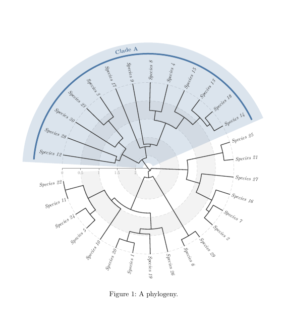

# CeTZ / Typst

Saving to `.typ` with `standalone=false` writes Typst code that draws the figure
with [CeTZ](https://typst.app/universe/package/cetz), to `#include` in a Typst
document. Without `standalone=false` the file compiles on its own.

!!! warning "Work in progress"
    Rotated tip labels and curved clade labels can come out at the wrong
    angle or spacing, depending on the CeTZ version. Check them in your
    output.

```julia
using PlotPhyloTree, Random
tree = randtree(30; rng=Xoshiro(1), labels=["Species_$i" for i in 1:30])
ladderize!(tree)
p = treeplot(tree; layout=:circular, italic=true, metrics=:lmroman)
highlight!(p, childnodes(tree, rootnode(tree))[1]; label="Clade A")
timescale!(p)
savefig("tree.typ", p; standalone=false, scale=0.8)
```

`main.typ`:

```typst
#set page(width: 16cm, height: auto)
#set text(font: "New Computer Modern")

#figure(
  include "tree.typ",
  caption: [A phylogeny.],
)
```

`typst compile main.typ`:



## Fonts

The branches, wedges, rings and symbols are drawn where the layout put them.
The labels are handed to Typst as text, so they use whatever
`#set text(font: …)` is in force where the file is included. Change the
document's font and the tree's labels change with it. To use a different font
for one figure, pass `font` (a name or a list of names) when saving.

The layout reserves room for labels before Typst sets them, so tell it which
font to measure with `metrics` in [`treeplot`](@ref): `:lmroman` (close to
New Computer Modern), `:lmsans`, `:times`, `:helvetica` (the default), or
[`fontmetrics`](@ref) with your document font's `.otf`/`.ttf` file.

Curved clade labels are measured by Typst: each letter is placed along the
arc using its width in the document font. Pass `curvedtext=:glyphs` to place
each letter where the layout put it instead.

## Options

[`cetzstring`](@ref) returns the code as a string. The default CeTZ version
needs Typst ≥ 0.13.1; for older Typst pass e.g. `cetz="0.3.0"` (Typst ≥ 0.11).
`scale` multiplies all lengths, font sizes included. A standalone file sets a
font matching `metrics`.
